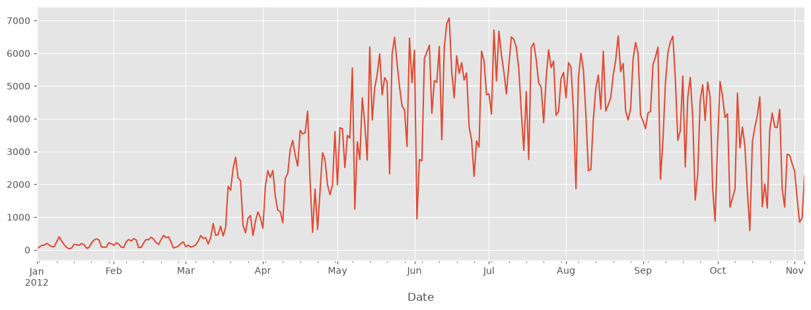
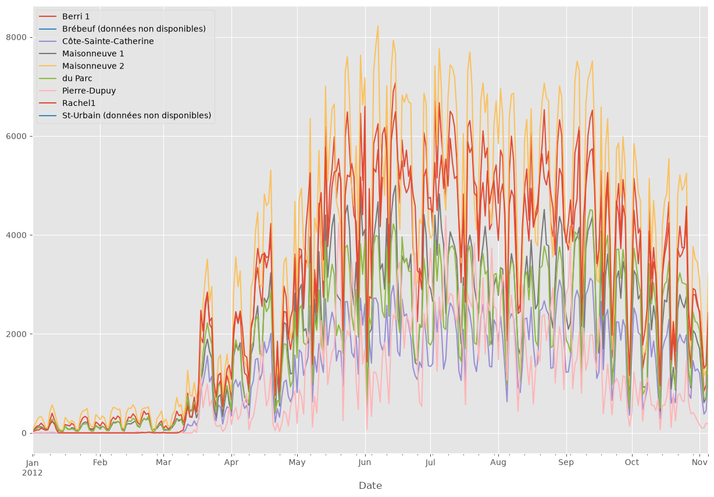

# Лабораторная работа № 1. Введение в Jupyter. Чтение данных из CSV

Первая лабораторная по курсу «Обработка данных»: освоился с Jupyter Notebook и загрузил в pandas реальный датасет —
количество велосипедистов на велодорожках Монреаля за 2012 год.

## Что сделано

1. **Работа в Jupyter.** Написал простую функцию `print_10_nums()` и с помощью магической команды `%time`
   сравнил скорость суммирования через list comprehension и через генератор (`sum([x for x in ...])` против `sum(x for x in ...)`).
   Результат одинаковый — `4999950000`, по времени на 100 000 элементов разница в пределах миллисекунды.
2. **Настройка окружения для графиков.** Подключил `%matplotlib inline`, стиль `ggplot` и размер фигур по умолчанию.
3. **Чтение CSV.** Файл `bikes.csv` «грязный» по формату, поэтому при чтении пришлось указать:
   - `sep=';'` — разделитель точка с запятой;
   - `encoding='latin1'` — во французских названиях колонок есть символы с диакритикой;
   - `parse_dates=['Date'], dayfirst=True` — даты в формате `ДД/ММ/ГГГГ`;
   - `index_col='Date'` — дата становится индексом, что удобно для временного ряда.
4. **Выбор данных.** Посмотрел первые строки таблицы и выбрал отдельный столбец `Berri 1` (первые 10 дней января).
5. **Визуализация.** Построил график по одной велодорожке и по всем сразу.

## Результаты

Велодорожка `Berri 1` за 2012 год: зимой почти никто не ездит, с апреля поток резко растёт, пик — июнь–август
(до ~7000 человек в день), к ноябрю снова спад.



Все велодорожки на одном графике: сезонность одинаковая, самые загруженные — `Maisonneuve 2` и `Berri 1`.
По `Brébeuf` и `St-Urbain` данных нет (колонки пустые).



## Структура

```
├── lab_01.ipynb   # решение
├── data/
│   └── bikes.csv  # данные о велосипедистах Монреаля, 2012
└── images/        # графики для README
```

## Запуск

```bash
pip install -r requirements.txt
jupyter notebook lab_01.ipynb
```
